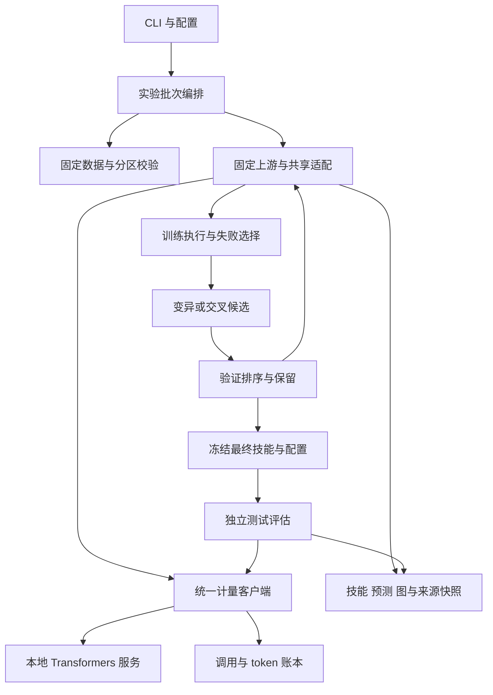
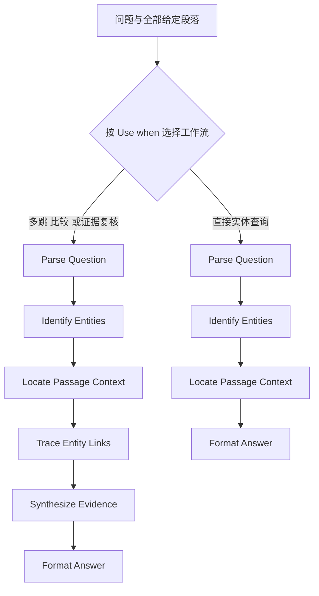

# 成员 A 复现设置与系统实现初稿

本稿供成员 A 提交复现与系统实现章节，并作为演示讲稿使用。我们使用同一个本地 Qwen3.5-9B，在 SearchQA 和 HotpotQA 上完成无技能、初始技能、原始 GraphSkillEvo 三项条件的开发和冻结测试。两个数据集各有三个实验种子，每个数据集完成 12 个开发子运行和 9 个测试子运行；B 的改进选择器与消融由 B 另外完成。

本稿由 C 按课程最多六页的要求整合进团队报告；模块细节、完整证据索引及演示讲稿可作为附录和演示材料。

本轮实验的主要发现是：原方法在验证集上的收益没有稳定转化为相对无技能的测试优势。SearchQA 的选定技能平均 EM/F1 均低于无技能；HotpotQA 的 EM 基本持平，F1 略低。复现结果应同时呈现两项基础基线、初始候选被保留的情况及实际计算成本。

## 复现设置

### 环境与模型

当前实验在原生 Linux 的 conda `jev` 环境中运行，使用 RTX 5090 32GB、Python 3.12.0、PyTorch 2.11.0+cu128 和 Transformers 5.17.0。依赖快照见 [Linux 依赖锁](../requirements/lock.linux.txt)，每个运行的 `environment.json` 保存当时实际版本。PDF 列出的参考硬件为 A6000，因此不能直接将本机延迟视作 A6000 的结果。

目标问答模型与技能优化模型均使用同一份用户提供的本地 Qwen3.5-9B 权重。当前机器通过 `.env` 的 `REPRO_MODEL_PATH` 指向 `/home/admin1/Qwen3.5-9B`；共享配置保留跨机器覆盖方式。服务仅从已有本地目录读取模型，启动不下载权重。

| 设置 | 实际值 |
|---|---|
| 数值精度与推理实现 | BF16、SDPA、逻辑 `cuda:0`，串行生成 |
| 输入与输出总窗口 | 16,384 token |
| 问答与优化器单次输出上限 | 均为 4,096 token |
| temperature / top_p / top_k | 0.6 / 1.0 / 50 |
| thinking | 关闭 |
| 请求超时 / HTTP 重试上限 | 360 秒 / 1 次 |
| 实验种子 | 0、42、127 |
| 优化器种子策略 | `optimizer_retry_v1`，格式重试采用已记录的派生种子 |

所有运行记录权重分片、tokenizer 和配置文件的 SHA-256，当前完整模型指纹为 `4ad832a15dda3d813ae76cf3c35204f0c8a358594c2858677752ddb3e49b0f69`。权重的上游下载 revision 尚未独立核实；文件指纹证明本轮使用同一份本地模型，不替代来源 revision 的证明。

GraphSkillEvo 固定在 [源码锁](../third_party/upstream.lock.json) 的 commit `722a8a913b05dc9d1b4078f0bec604cde4dc7529`。上游源码保持不变；本项目在 `src/repro/integration/` 中实现共享的课程规模限制、数据和模型桥接及产物导出。

### 数据与划分

| 数据集 | train / val / test | 协议与固定数据 |
|---|---:|---|
| SearchQA | 100 / 30 / 50 | PDF 的课程规模；上游固定 ID；[数据清单](../manifests/data-v1/searchqa.json) |
| HotpotQA | 300 / 150 / 1000 | [hotpot_split.md](../hotpot_split.md) 的 distractor 分层协议；[数据清单](../manifests/hotpotqa-stratified-v2/hotpotqa.json)、[三份原始 ID 列表](../manifests/hotpotqa-stratified-v2/ids.json) |

HotpotQA 以专用的 `hotpot_split.md` 为划分依据：从官方 train 的 easy、medium、hard 各选 100 条训练和 50 条验证，验证排除全部训练 ID；从官方 distractor dev 选择 1,000 条作为项目留出测试。三个原始 ID 集合互不相交，所有条件共用同一划分。该测试集不是官方隐藏测试集。

数据抽样种子固定为 42。实现使用种子与原始 ID 的 SHA-256 排序，在每个难度内依次分配训练和验证，测试在官方 dev 中独立排序选择；它不依赖 Parquet 行顺序或模型成绩。SearchQA、HotpotQA 的来源 revision 分别为 `c1a979068ba118d85467179b704031d113d689cc`、`1908d6afbbead072334abe2965f91bd2709910ab`，原始文件校验值保存在清单中。

HotpotQA 求解输入保留 distractor 中提供的全部段落，不加入外部检索、参考答案或 supporting-fact 标签。SearchQA 复用上游问答模板及 6,000 字符上下文截取规则。参考答案仅参与评分和训练失败反馈，不送入目标问答模型。

当前 `hotpot_split.md` 已将测试数量统一写为 1,000；历史清单锁定的是修订前的说明字节，其实际数据已经是 300/150/1000。当前说明的 SHA-256 为 `da13133aa6ff4ca8f9511516ad887ad459d1fcd7de6cebdbefa269037a8de923`，历史清单记录 `47d0623b7c263ce8011a06ac0da5e53e6a1be03d9298b84ec8f53b171d16fc85`。本轮数据、ID、运行和历史校验值保持原样；代码中的 `hotpotqa.provisional` 名称及历史状态字段继续保留。新的 HotpotQA 准备／正式开发预检目前会因说明哈希不同而拒绝，需在后续新实验前明确处理版本迁移；[B/C 的 pilot 验收](reproduction-acceptance.md)不经过这一新分层说明检查。

### 训练与验证各自承担的职责

训练样例产生问答执行结果、EM=0 失败及包含训练参考答案的反馈，供优化器修改技能。每次训练评估抽取 15 条，每次优化最多选择 3 条失败；原选择器对当前训练失败池进行带种子的随机抽样。

验证集负责候选排序、父代抽样权重、幸存者保留和最终技能选择。初始化种群大小为 2，包含提供的初始技能及模型生成的初始化候选；每轮最多产生两个新评估候选，运行三轮。算子按 `mutation_other`、`mutation_graph`、`crossover_other`、`crossover_graph` 轮转，因此第 1、3 轮使用两种变异，第 2 轮使用两种交叉。

验证集会重复使用，因此验证成绩含选择偏差。测试在全部开发运行结束、最终技能和推理设置冻结后进行，测试阶段不调用优化器。每个种子另有一次选定技能的独立加载验证，它检查存取和评分一致性，不算额外的独立种子。

| 每条件预算上限 | SearchQA | HotpotQA |
|---|---:|---:|
| 模型调用次数 | 600 | 3,000 |
| 生成 token | 2,000,000 | 10,000,000 |

HotpotQA 的验证规模为 SearchQA 的五倍，相应调用与输出预算扩大五倍。B 的原方法、改进和消融必须在各数据集内部使用相同上限，同时报告实际消耗；相同轮数不等于相同成本。40 GPU 小时为课程规划上限，不能当作已实测耗时。

## 系统实现

CLI 只解析和分发参数，实验模块组织条件与种子，数据、模型通信、评分、存储和可视化分别由独立模块负责。技能结构通过系统提示提供给问答模型；当前 QA 执行是单次生成，不是逐节点运行工具或 Python 程序的图执行器。



| 模块 | 职责与可追溯产物 |
|---|---|
| `config.py`、`cli.py` | 配置合并、参数检查和命令分发；生效配置保存为 `config.json` |
| `datasets/` | 校验文件哈希、来源、ID 顺序和分区；进化加载器只持有 train/val |
| `experiments/` | 组织基线、进化、独立验证、冻结测试和中断后的测试续跑 |
| `integration/` | 连接固定上游；限制轮数、候选数及优化器尝试；保留上游输入和算子语义 |
| `selectors/` | 原训练失败选择器；B 通过注册 `improved`、`ablation` 替换选择策略 |
| `inference/`、`serving/` | 同一模型服务与统一计量；问答和优化器请求分别标记角色 |
| `evaluation/` | C 负责的答案提取、EM/F1 和保存预测的汇总接口 |
| `artifacts/`、`visualization/` | 配置、模型、环境、数据快照；原始提示／响应；技能图、谱系与验证历史 |

答案取最后一个 `<answer>...</answer>`，缺少标签时取最后一行非空文本；归一化统一大小写、去标点、英文冠词和多余空白。EM 比较归一化后的完整答案，F1 根据 token 重叠计算，多参考答案取最高分。HotpotQA 另保留官方答案指标对 yes/no/noanswer 不匹配的特殊处理；本项目不把答案分数称为支持事实或联合指标。

每个模型请求在发出前预留生成额度，并在结束后记录实际 token、角色、请求状态与耗时。初始化、格式不合格、失败和重试都计量；未知 usage 保留为未知。问答输出达到固定上限时保留原文、计零分并标记截断；优化器截断或技能格式错误在原有尝试预算内重试，不提高生成上限。

模型服务正常结束时释放本批次启动的进程；手动逐条件运行则连接单独启动的服务。强制结束进程或机器关机可能留下部分结果和未完成请求，不能把其用量补成零。测试续跑保留完成子运行，其余子运行写入新目录；它不支持逐题续跑或恢复进化中间状态。

## 实验结果与技能演化

以下均为当前 Linux 批次的测试结果，EM/F1 为三个种子的百分比均值 ± 样本标准差，延迟为平均每题秒数。每个数据集的测试 ID 在三个种子间相同，不将这些记录当作互不重复的新题。

| 数据集 | 条件 | 测试 EM | 测试 F1 | 延迟 s |
|---|---|---:|---:|---:|
| SearchQA | 无技能 | 64.67 ± 1.15 | 71.88 ± 1.53 | 1.82 |
| SearchQA | 初始技能 | 62.67 ± 1.15 | 70.63 ± 0.99 | 4.18 |
| SearchQA | 原方法选定技能 | 63.33 ± 1.15 | 69.73 ± 0.70 | 3.55 |
| HotpotQA | 无技能 | 63.40 ± 0.82 | 78.24 ± 0.66 | 2.19 |
| HotpotQA | 初始技能 | 60.93 ± 0.15 | 74.93 ± 0.44 | 1.40 |
| HotpotQA | 原方法选定技能 | 63.43 ± 0.25 | 77.53 ± 0.23 | 3.97 |

SearchQA 的选定技能相对无技能低 1.33 个 EM、2.15 个 F1 百分点；相对初始技能 EM 仅增加 0.67 个百分点，F1 降低 0.91。HotpotQA 的选定技能相对初始技能恢复了部分损失，但与无技能的 EM 差仅约 0.03 个百分点，F1 仍低约 0.71，平均延迟也更高。结果支持“流程已复现”，不支持“原方法稳定优于无技能”的结论。

### 哪些种子真正选择了后续更新

| 数据集 | seed | 最终候选 | 来源 | 验证 EM / F1 |
|---|---:|---|---|---:|
| SearchQA | 0 | `g0001_i0000` | 第 1 轮 `mutation_other` | 66.67 / 76.56 |
| SearchQA | 42 | `g0000_i0000` | 提供的初始技能 | 66.67 / 72.52 |
| SearchQA | 127 | `g0000_i0000` | 提供的初始技能 | 56.67 / 67.67 |
| HotpotQA | 0 | `g0002_i0000` | 第 2 轮 `crossover_other` | 72.67 / 81.61 |
| HotpotQA | 42 | `g0000_i0001` | 模型生成的初始化候选 | 72.67 / 82.77 |
| HotpotQA | 127 | `g0000_i0001` | 模型生成的初始化候选 | 70.67 / 80.96 |

后两种初始化来源必须区分：`initial_skill` 基线是提供的技能文件，`llm_initialization` 是优化阶段额外生成的候选。HotpotQA seed42、127 保留生成的初始化候选，不能描述成第三轮更新带来的收益。

SearchQA seed0 的验证历史如下。原始技能和每个候选的图、父代及保留决定均在运行目录中：

| 阶段 | 新候选与验证 EM | 本阶段结束时最佳验证 EM |
|---|---|---:|
| 初始化 | 提供的技能 53.33；生成的候选 46.67 | 53.33 |
| 第 1 轮 | `mutation_other` 66.67；`mutation_graph` 53.33 | 66.67 |
| 第 2 轮 | 两种交叉均为 60.00 | 66.67 |
| 第 3 轮 | `mutation_other` 60.00；`mutation_graph` 63.33 | 66.67 |

选中的修改加强了实体类型、答案简短、上下文依据和输出长度要求，验证 EM 比提供的初始技能增加四题正确。后续候选未超过它，因此保留第 1 轮候选。该候选的 `Node Lists` 和 `Task Graphs` 仍为空，实际变化集中在 Global Guidance；应展示原图的“未声明节点／工作流”状态，不能据此声称学出了复杂图结构。其测试 EM 仅从 62% 到 64%，净多一题正确，F1 则从 71.72% 降至 69.00%。这是收益未稳定迁移的观察，具体原因仍需 C 用开发证据诊断。

HotpotQA seed42 的生成初始化候选则声明了明确的工作流。下图按其归档技能简化展示路由和节点顺序，完整节点指令以原技能文件为准：



该技能的验证 EM 为 72.67%，高于提供的初始技能 67.33%；后续三轮未选到更好的最终候选。测试 EM 为 63.20%，相对该种子无技能的 62.70% 仅增加五题，F1 从 77.68% 降到 77.31%。图中路由是提示词所声明的流程，当前系统没有逐节点执行日志来证明模型每次实际遵循它。

## 工程限制与成本

| 当前 Linux 批次 | 开发调用 / 优化器调用 | 测试调用 | 输入 token 总数 | 输出 token 总数 | 开发 / 测试 QA 截断 |
|---|---:|---:|---:|---:|---:|
| SearchQA | 1,266 / 36 | 450 | 2,922,799 | 220,528 | 5 / 3 |
| HotpotQA | 4,498 / 28 | 9,000 | 26,658,281 | 2,046,357 | 4 / 20 |

这些已完成批次没有 HTTP 失败、HTTP 重试、pending 调用或未知用量；优化器格式重试已计入优化器调用。SearchQA 开发与测试墙钟合计约 69 分 28 秒，设备总显存采样峰值为 21,499 MiB，约 21.00 GiB。HotpotQA 开发约 3 小时 37 分，测试曾中断并续跑一次；不能把最终 `summary.json` 的续跑段耗时当作整个测试批次耗时，应合并分段日志。设备采样不是模型独占显存或 CUDA 内核时间。

表中成本只覆盖当前 Linux 的两套完成批次，不是全组 40 GPU 小时总账。旧 Windows 运行、试跑、中断运行及其未知用量需要在组级资源记录中另外保留，不能通过只汇总成功批次将它们丢弃。

重复验证会产生选择偏差；SearchQA 仅 50 道固定测试题，三个种子不增加独立题数。两个数据集的规模、单题输入和预算不同，不能把它们的分数或延迟简单合并成单一任务成绩。当前只完成 A 的条件，不能据此判断 B 的方法有效，也不能用已看到的测试失败继续设计 B 的选择器。

一次性自动核验触发器因当前 Python 缺少 `os.pidfd_open` 而失败，SearchQA 随后使用只读脚本完成核验并通过。该临时触发器不是正式复现入口，不能直接复用。正常的批次入口、手动审计和原始实验结果均有独立记录。

## 演示流程与讲稿

建议用保存的开发证据进行约 7 分钟演示，不重跑正式测试。现场需要真实推理时，只运行 [README 的 B/C pilot 流程](../README.md#b-c-独立复现验收)，它不含测试样例。

1. **第 1 分钟，展示设置与数据。** 打开 `config.yaml`、`hotpot_split.md`、两套固定数据清单和 HotpotQA 的 `ids.json`。讲稿：“训练用于产生更新反馈，验证用于选择，测试在冻结后只做最终评估。数据抽样种子始终是 42，实验种子是 0、42、127。”
2. **第 2 分钟，展示一次运行如何追溯。** 打开 SearchQA seed0 `original` 目录的 `config.json`、`model_identity.json`、`data_manifest.json`、`environment.json`。讲稿：“每个数值都能定位到同一份模型、数据、配置和来源记录；跨机器路径可以不同，文件身份和协议必须明确。”
3. **第 3 至 4 分钟，回放进化。** 展示 `history.jsonl`、`skills/`、`graphs/lineage.mmd`，按上表依次指出初始化、第一轮提升和后两轮保留决定。再打开 HotpotQA seed42 的技能内部图，说明内部路由图与候选父子谱系图的区别。
4. **第 5 分钟，核对一条开发预测。** 从 `selected_val` 的 `predictions.jsonl` 中取一条，定位同次 `evaluations/.../predictions/<ID>/` 的提示、响应与 `result.json`。讲稿：“先提取答案，再归一化计算 EM/F1；截断回答保持原文并计零分。C 可以直接重算，而不重新调用模型。”
5. **第 6 分钟，展示成本。** 打开 `calls.jsonl`、`operators/call_*.json` 和 `run_summary.json`，关联一次优化器尝试、角色、token 与失败／重试记录，说明 unknown 不等于零。
6. **第 7 分钟，报告结论与边界。** 展示本稿的测试表、两份审计和失败清单。讲稿：“当前没有稳定超过无技能；有的种子保留初始化候选。我们保留这些负面结果，并将开发诊断交给 B/C，测试分析不回流方法开发。”

可在仓库根目录运行以下只读命令展示保存的独立验证汇总：

```bash
conda activate jev
python -m repro summarize --run outputs/linux-transformers/formal/20261106T062905782349Z-a93345/runs/seed-0/searchqa/selected_val/20261106T064230866151Z-e78842
```

该命令应显示 30 条唯一验证样例，EM 为 0.666666…、F1 为 0.765555…；它只读取预测，不发出模型请求。

## 代码面试自检

- 能指出训练失败池来自哪里、原选择器怎样抽样，以及 B 的策略如何注册而不改变优化器输入。
- 能解释父代、幸存者与最终技能为何使用验证成绩，以及重复使用验证集的风险。
- 能区分提供的初始技能、模型生成的初始化候选、后续变异／交叉候选。
- 能从 `run_summary.json` 追溯到单题提示、模型响应、答案提取及调用账本。
- 能解释为什么当前 QA 的技能图不等同于逐节点执行轨迹，为什么保留初始化候选也是有效实验结果。
- 能说明正常结束、异常、中断、未知用量与续跑如何保存；能解释本机硬件和模型来源限制。

## 交付与证据索引

| 内容 | 当前 Linux 原始证据 |
|---|---|
| SearchQA 开发 | [开发批次摘要](../outputs/linux-transformers/formal/20261106T062905782349Z-a93345/summary.json) |
| SearchQA 测试 | [测试批次摘要](../outputs/linux-transformers/heldout-searchqa/20261106T071330771928Z-9e2604/summary.json) |
| SearchQA 重算、逐种子表、失败清单与示例图 | [审计报告](../outputs/reports/searchqa-linux/20261106T074952Z/audit-results.json)，同目录有 `audit.py`、CSV 和六份 Mermaid 图 |
| HotpotQA 开发 | [开发批次摘要](../outputs/linux-transformers/provisional-hotpotqa/20261105T072112040851Z-f6995e/summary.json) |
| HotpotQA 测试与分段历史 | [测试批次摘要](../outputs/linux-transformers/heldout-hotpotqa/20261105T112146929163Z-4a94eb/summary.json)，同目录保留原分段摘要和事件 |
| HotpotQA 逐题重算与成本 | [Linux 审计报告](../outputs/reports/linux-audit/20261106T031855Z/audit-results.json) |
| 各轮技能、父子关系与保留决定 | 各开发 `original/<run>/` 的 `skills/`、`history.jsonl`、`graphs/`、`upstream/` |
| B/C 独立复现与签字记录 | [复现验收记录](reproduction-acceptance.md) |

SearchQA 核验了 1,230 条开发和 450 条测试预测，12,343 个原始文件在审计前后保持相同哈希。HotpotQA 核验了 4,470 条开发和 9,000 条测试预测，31,718 个开发和 63,150 个测试文件保持相同哈希。两份审计状态均为 `passed`。

`outputs/`、数据、缓存和模型不随普通 Git 提交交付。B/C 需要另外收到相关完整原始批次、报告、固定数据及清单；B 的开发材料不应混入测试失败清单。写好说明不等于完成 B/C 的独立验收，验收表由实际执行人填写。
